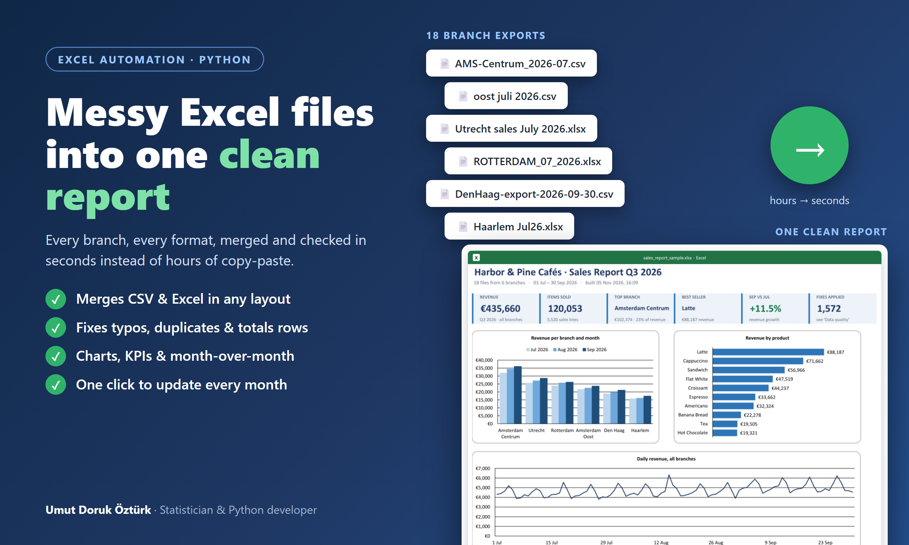
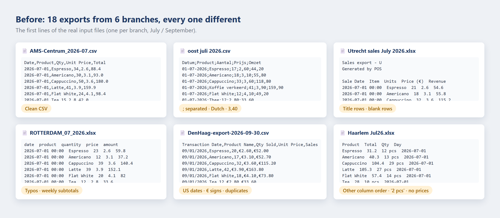
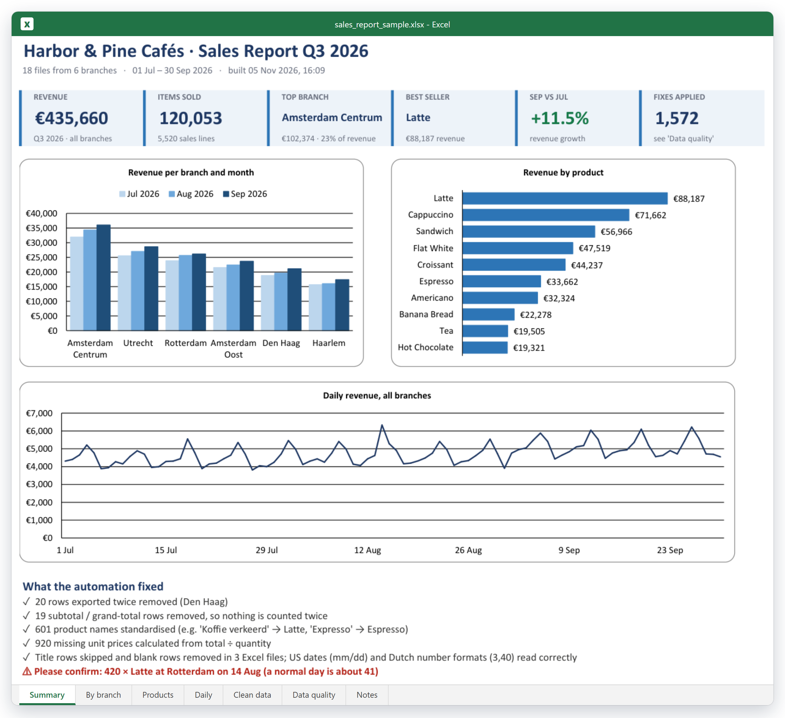
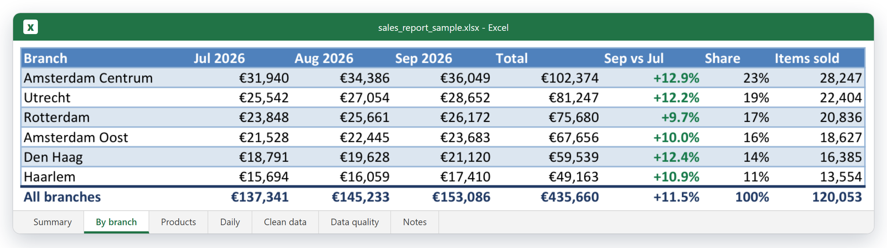
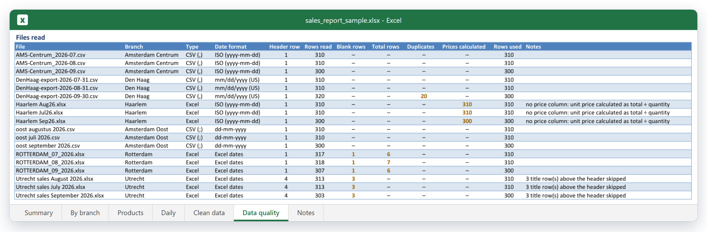
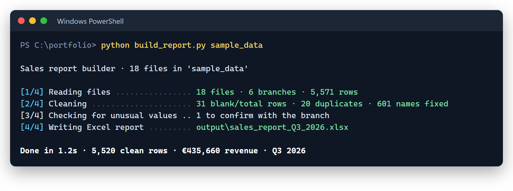

# Messy Excel Files → One Clean Report: Sales Report Automation

**Merges every branch's sales export (different formats, languages, typos and all) into one clean, formatted Excel report with KPIs and charts. Monthly reporting goes from hours of copy-paste to one click.**



---

## The problem

> *"Every month our 6 branches send their sales exports. Each one uses a different till system, so the columns, dates and product names never match. Someone spends a day copy-pasting it all into one report, and the totals are never quite right."*

## The result

| | |
|---|---|
| **Files merged** | 18 (6 branches × 3 months), CSV and Excel |
| **Rows** | 5,571 read → 5,520 clean sales lines |
| **Fixed automatically** | 1,572 problems: duplicate rows, subtotal rows, 601 product names, 920 missing prices |
| **Flagged for a person** | 1 likely typing error (420 lattes on a normal ~41 day) |
| **Run time** | about 1 second |

📥 **[Download the sample report](sample_output/sales_report_sample.xlsx)** · [clean data CSV](sample_output/clean_data_sample.csv) · [the messy input files](sample_data/)

### Before: every branch exports differently



### After: one report

**Summary**: revenue, best branch and best seller, growth, three charts and a plain-English list of what was fixed.



**By branch**: revenue per month, total, growth and share.



**Data quality**: what was found in every file, so you can trust the numbers.



---

## What gets cleaned, without any per-branch code

| Problem in the exports | What the tool does |
|---|---|
| Title rows above the header, blank rows in between | Finds the real header row by its column names |
| Column names in English or Dutch, in any order | Maps *Datum / Sale Date / Transaction Date / Day* → **Date** (and so on) |
| `,` or `;` separated CSV, decimal commas (`3,40`), `€3.40`, `2 pcs` | Detects the delimiter and reads every number format |
| Dates as `01-07-2026`, `07/13/2026` (US) or real Excel dates | Works out the day/month order per file |
| Weekly subtotal and grand-total rows | Removed, so nothing is counted twice |
| Rows exported twice | Removed (20 in Den Haag, September) |
| `cappucino`, `Expresso`, `LATTE `, `Koffie verkeerd` | Matched to the official product list (fuzzy matching + aliases) |
| No unit price column | Calculated as total ÷ quantity |
| A quantity 10× higher than normal | **Flagged, not deleted.** A robust z-score (median/MAD) finds it, and a person confirms it |

## The report

| Sheet | Contents |
|---|---|
| **Summary** | KPIs, revenue per branch and month, revenue by product, daily trend, what was fixed |
| **By branch** | Month-by-month revenue, total, growth, share, items sold |
| **Products** | Units, revenue, average price and share per product, by month |
| **Daily** | Revenue per day, per branch |
| **Clean data** | Every sales line in one standard format (filterable, ready for a pivot table) |
| **Data quality** | Per-file log, product name corrections, unusual values |

A clean CSV of all sales lines is written too, ready for Power BI, Google Sheets or a database.



## Run it yourself

```bash
pip install -r requirements.txt
python build_report.py sample_data
```

Or put next month's exports in an `exports` folder and double-click `run.bat`. Your branches, product list and column names live in [`sales_report/config.py`](sales_report/config.py).

Run the tests with `python -m pytest` (14 tests).

## Project structure

```
sales-report-automation/
├── build_report.py            # command-line entry point
├── run.bat                    # double-click launcher for Windows
├── sales_report/
│   ├── load.py                # reads any export: header row, columns, delimiter, numbers, dates
│   ├── clean.py               # product name matching, unusual-value detection
│   ├── report.py              # the formatted Excel report with charts
│   └── config.py              # branches, products, column names
├── tests/                     # pytest tests
├── sample_data/               # 18 fictional, deliberately messy exports
├── sample_output/             # the report shown above
└── tools/make_sample_data.py  # generates the sample exports
```

**Tech:** Python · pandas · openpyxl (native Excel charts and tables) · difflib · pytest

## About the sample

All data is **fictional**, generated by [`tools/make_sample_data.py`](tools/make_sample_data.py) for a made-up café chain. The problems in the files (typos, duplicates, subtotals and one typing error) were put there on purpose to show what the tool handles.

---

## Need something like this?

I automate recurring Excel and reporting work: **merging files from branches, stores or systems, cleaning messy data, monthly KPI reports, dashboards**. You get a one-click tool and a report you can trust.

**Umut Doruk Öztürk** · Statistician (METU) & Python developer
[Upwork](https://www.upwork.com/freelancers/YOUR-PROFILE) · [Fiverr](https://www.fiverr.com/YOUR-USERNAME) · [LinkedIn](https://www.linkedin.com/in/umut-doruk-ozturk)
